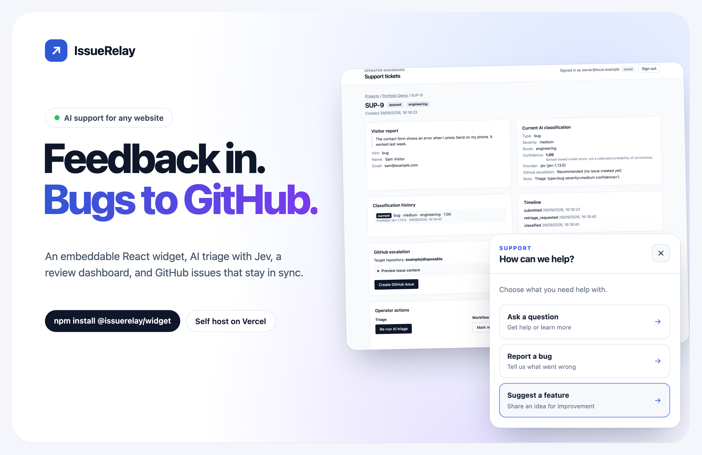
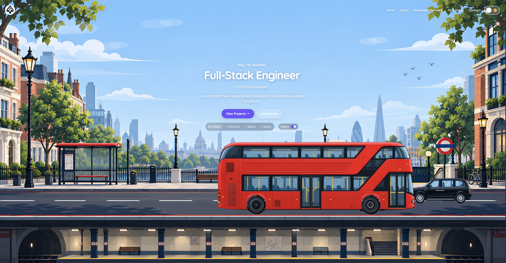
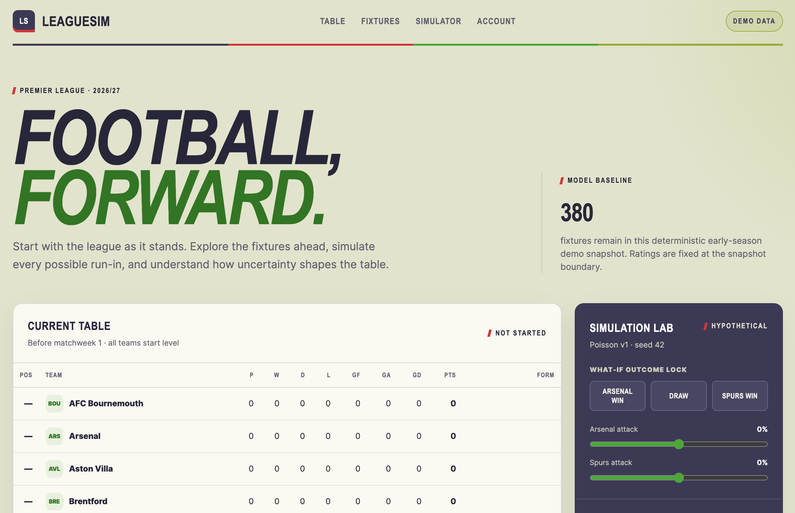

<h1 align="center">Andrew Baisden</h1>

  <strong>Full-Stack Engineer</strong> 
  Building modern web applications with TypeScript, React,
  Next.js, Node.js and PostgreSQL.

  <a href="https://andrewbaisden.com/">Portfolio</a> •
  <a href="https://www.linkedin.com/in/andrew-baisden/">LinkedIn</a> •
  <a href="https://dev.to/andrewbaisden">Technical Writing</a> •
  <a href="https://twitter.com/andrewbaisden">X</a>

---

## 👨‍💻 About

I'm a full-stack engineer focused on building reliable,
production-ready web applications.

My current work centres around TypeScript, React, Next.js,
Node.js and PostgreSQL, alongside AI-powered applications,
developer tooling and automation.

I care about clean architecture, maintainability,
performance and developer experience.

---

## 🚀 Featured Projects

### 📨 IssueRelay

Website feedback usually lands in scattered inboxes, and bug reports get copied into GitHub by hand, sometimes with a visitor's private details still in them. **IssueRelay** is an AI support system with **an embeddable React widget, AI triage with Jev, a review dashboard, and confirmed bugs routed to GitHub as issues that stay in sync**.

Built with **Next.js** as a modern way to collect, triage, and act on feedback from any website, with the widget published on npm and running on my portfolio.

Tech stack: **TypeScript · Next.js · React · PostgreSQL · Drizzle · Tailwind CSS · Zod · better-auth · Jev · GitHub Apps · Vitest · Playwright**

→ <a href="https://www.npmjs.com/package/@issuerelay/widget">npm Package</a> · <a href="https://github.com/andrewbaisden/issuerelay">Source Code</a>

---

### ✈️ Travel Planner Application

Turning travel preferences into a detailed itinerary often means piecing together destinations, attractions, and practical tips by hand. **Travel Planner Application** is an AI travel planner with **local Ollama models, optional Groq models through Agno, and simple or five-phase agentic workflows** that plan, research, generate, review, and improve personalised itineraries.

Built with **Next.js** as a modern way to turn travel preferences into structured plans, backed by a Python API and an alternative Gradio interface.

Tech stack: **TypeScript · Next.js · React · Tailwind CSS · Python · FastAPI · Gradio · Ollama · Agno · Groq**

→ <a href="https://github.com/andrewbaisden/travel-planner-ai-agent-app">Source Code</a>

---

### 🌐 Portfolio website

Presenting engineering work online calls for a clear introduction and a memorable way to explore it. **Portfolio website** is my personal engineering portfolio with **switchable animated London, mountain, beach, and space scenes, day/night themes, a validated contact form, and an integrated IssueRelay support widget**.

Built with **Next.js** as a modern way to share my work, technical background, and writing through an interactive, responsive website.

Tech stack: **TypeScript · Next.js · React · CSS · React Hook Form · Zod · Resend · IssueRelay · Vitest · Playwright · Netlify**

→ <a href="https://andrewbaisden.com/">Live Demo</a> · <a href="https://github.com/andrewbaisden/andrew-baisden-portfolio">Source Code</a>

---

### ⚽ LeagueSim

Forecasting a Premier League season usually means opaque models or guesswork. **LeagueSim** is a football analytics platform that uses **seeded Monte Carlo simulations** and an **explainable Poisson model** to forecast standings, title chances, European qualification, and relegation.

Built with **Next.js** as a modern way to simulate seasons and inspect hypothetical outcomes.

Tech stack: **TypeScript · Next.js · React · PostgreSQL · Prisma · Tailwind CSS · Redis · BullMQ**

→ <a href="https://web-ten-pied-wn5lzh6lq8.vercel.app/">Live Demo</a> · <a href="https://github.com/andrewbaisden/league-sim">Source Code</a>

---

## 🛠️ Tech Stack

### Core

TypeScript · React · Next.js · Node.js · PostgreSQL

### Frontend

CSS · Tailwind CSS · shadcn/ui · React Hook Form · TanStack Query · Zustand · Konva · Leaflet · Three.js · React Three Fiber

### Backend & Data

Node.js · Python · FastAPI · Gradio · PostgreSQL · Drizzle · Prisma · Zod · Redis · BullMQ · Fastify · SSE · better-auth · Resend

### Testing & DevOps

Vitest · Playwright · Docker · GitHub Actions · AWS · Vercel · Netlify · Fly.io

### AI Engineering

LLM APIs · Structured Outputs · Tool Calling · RAG · MCP · Jev · Ollama · Agno · Groq

---

## 🧠 Engineering Focus

- Full-stack architecture
- API design
- Database design
- Testing and CI/CD
- Performance and observability
- AI agents and LLM applications
- Developer tooling and automation

---

## 🔭 Currently

Building and experimenting with production-ready full-stack
and AI applications while deepening my knowledge of system
design, cloud infrastructure and AI engineering.

---

## ✍️ Technical Writing

I write about software engineering, AI systems,
developer tooling and modern web development.

<!-- BLOG-POST-LIST:START -->
- [The 5 Best MCP Gateways for Enterprise Scale in 2026](https://dev.to/andrewbaisden/the-5-best-mcp-gateways-for-enterprise-scale-in-2026-504g)
- [Configuring Data Access Control &lpar;DAC&rpar; Team Level Visibility for Enterprise AI Governance](https://dev.to/andrewbaisden/configuring-data-access-control-dac-team-level-visibility-for-enterprise-ai-governance-1nii)
- [From Vibe Coding to Vibe Computing](https://dev.to/andrewbaisden/from-vibe-coding-to-vibe-computing-4gfm)
- [LLM Guardrails in Production and How Bifrost Protects Your AI Agents at the Gateway Level](https://dev.to/andrewbaisden/llm-guardrails-in-production-and-how-bifrost-protects-your-ai-agents-at-the-gateway-level-mc6)
- [How Bifrost&#39;s MCP Gateway Cuts AI Agent Token Costs by 92% Without Sacrificing Capability](https://dev.to/andrewbaisden/how-bifrosts-mcp-gateway-cuts-ai-agent-token-costs-by-92-without-sacrificing-capability-237i)
<!-- BLOG-POST-LIST:END -->

→ <a href="https://dev.to/andrewbaisden">Read more articles</a>

---

## 📊 GitHub

---

## 🤝 Connect

<a href="https://andrewbaisden.com/">Portfolio</a> · <a href="https://www.linkedin.com/in/andrew-baisden/">LinkedIn</a> · <a href="https://twitter.com/andrewbaisden">X</a> · <a href="https://dev.to/andrewbaisden">DEV</a> · <a href="mailto:info@andrewbaisden.com">Email</a>
